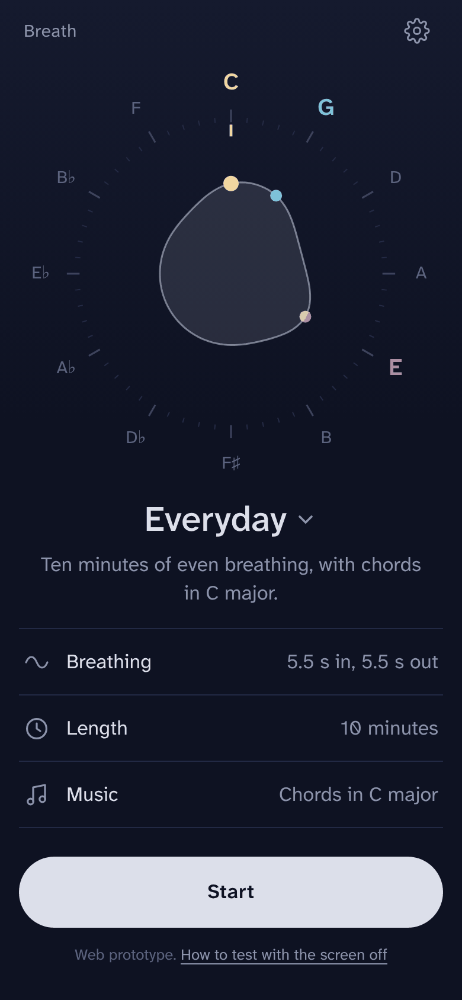
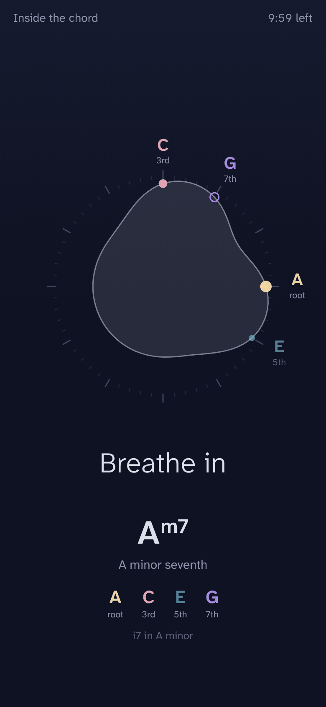

# Breath

A slow-breathing pacer that plays chords with your breath, in the browser.

**[Open Breath](https://fromanalysis.github.io/breath_app/)** · no install, no account

<p>
  
  &nbsp;
  
</p>

> **Early prototype.** It works, but it has only been tested on a few devices, and how it behaves with the screen locked depends on the browser (see [Browsers](#browsers)).

## What it is

Breath paces slow, even breathing, usually around five or six breaths a minute. While you breathe, it plays a soft synthesized pad. The chord changes as you turn from breathing in to breathing out, so a session walks you through a key or around the circle of fifths without you having to do anything but listen.

The idea is to get a feel for harmony passively. Names are on screen if you want them, but you never have to read them.

- **The tuning dial** places the twelve notes in circle-of-fifths order. A soft shape fills with each breath and reaches toward the notes that are sounding.
- **Colour means role, not pitch.** The root, third, fifth and seventh each have their own colour, which stays the same in every key.
- **Note focus,** if you turn it on, slowly brings one chord tone forward and lets the others recede, in the sound and on the dial together.

## Features

- **Sessions:** Everyday, Wind down, Sleep, Around the circle, Key tour, Inside the chord.
- **Breathing patterns:** 5.5 s in and 5.5 s out; 6 and 6; 4 in and 6 out; box (4-4-4-4); 4-7-8; or your own timings.
- **Music:**
  - The diatonic circle in any major or minor key, with triads or seventh chords, optionally moving to a new key every couple of rounds.
  - The circle of fourths in ten chord colours, from plain major to augmented-major seventh.
  - A single drone chord, or singing bowls.
- **Shaping the harmony:** a chord on each half-breath or on each breath; quick or gradual blends; a bass on the roots or a smoother bass line with inversions.
- **Display:** the chord and its notes spelled correctly (F♯ major's vii° is E♯°, not F°), only the chord name, or only the breath.
- **Language:** English and Russian.

Your settings stay in your browser. The app has no accounts, no analytics and no server. The only outside request is for the font, from Google Fonts.

## Using it

Open the link and press **Start**. Tap the screen during a session to pause or end it.

On a phone, use the browser's **Add to Home screen** to open it like an app.

By default the screen stays on during a session. To find out whether your browser keeps the sound going with the screen locked:

1. Turn off **Keep the screen on** in Settings.
2. Start a session and lock the phone for a few minutes.
3. When you unlock it, a note tells you whether the sound kept going the whole time.

## Browsers

Breath needs a browser with the Web Audio API and AudioWorklet: current Chrome, Edge, Firefox or Safari. Older browsers fall back to a slower audio path that works less well with the screen off.

- **Android:** browsers usually keep playing with the screen locked.
- **iPhone and iPad:** Safari usually stops web audio when the screen locks, so keep the screen on there. This hasn't been tested on an iPhone yet.

If the browser does stop the sound, the session pauses where it stopped and continues when you press Resume.

## How it works

Everything happens in the browser:

- `src/engine.js` holds the breath timeline, the harmony and voice leading, note focus, and the synthesizer (detuned saw pads through a soft low-pass filter, with reverb). The page and the audio thread both load this same file.
- The sound is synthesized in an **AudioWorklet**, sample by sample, as a function of time since the session started.
- The screen reads the audio clock (`AudioContext.getOutputTimestamp`), so the dial and the words follow what you actually hear. They don't run on a separate timer.
- The voice leading keeps four upper voices within E3–E5. They move by the smallest steps between chords, and every chord tone is heard (except a fifth that a seventh chord can do without).

## Development

`index.html` is the whole app and needs no build tools to run. It's generated from three source files:

- `src/engine.js`: the timeline, harmony and synthesizer
- `src/app.js`: the screens, settings, dial drawing and audio clock
- `src/body.html`: the markup and styles

After editing, rebuild and run the tests (Python 3 and Node.js):

```sh
python3 build.py
node test/engine.test.js
```

The tests check note spelling, the chord programs, voice leading and inversions, note focus, and a full render of every sound mode.

To run your own copy, fork the repository and enable **Settings → Pages → Deploy from a branch** (`main`, `/ (root)`).

## Not medical advice

Breath is a hobby project, not a medical device. If slow breathing makes you dizzy or uncomfortable, stop and breathe normally.

## Licence and credits

- **Code:** [CC0 1.0](LICENSE), public domain. Use it however you like.
- **Font:** [Atkinson Hyperlegible Next](https://www.brailleinstitute.org/freefont/) by the Braille Institute, used under the SIL Open Font Licence and loaded from Google Fonts.
